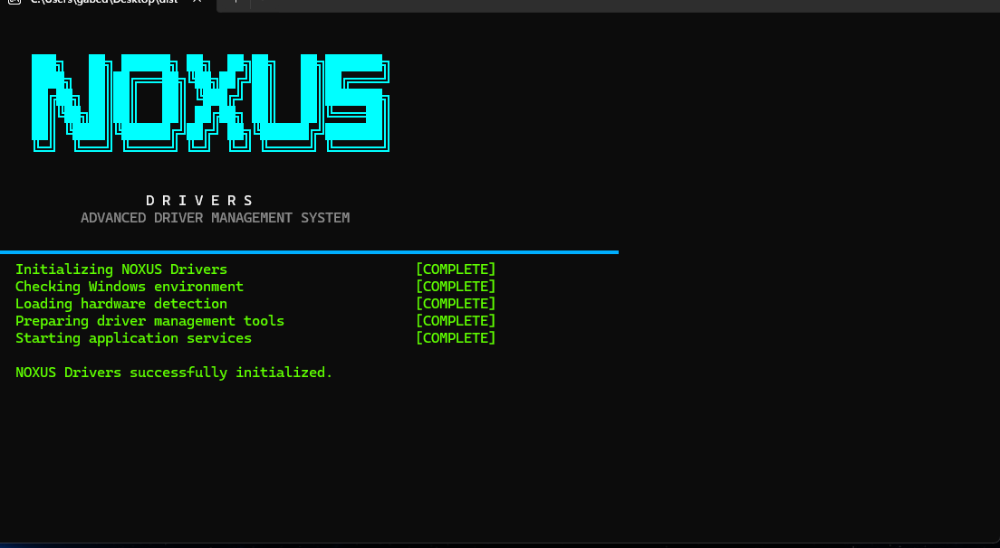

# NOXUS Drivers

### Advanced Windows Driver Management Toolkit

NOXUS Drivers is a Windows-based driver management utility built with Python. It helps users inspect installed drivers, check device health, back up driver packages, restore drivers, and generate detailed system reports.

## Features

- **Driver Scanner** — Scan and list installed Windows drivers.
- **Driver Database** — View installed driver information.
- **Driver Search** — Search by device name, manufacturer, version, INF, or device ID.
- **Driver Sorting** — Sort drivers by device, manufacturer, version, or date.
- **Driver Details** — Inspect individual driver information.
- **Device Health Check** — Detect Windows device errors.
- **Driver Backup** — Back up available third-party driver packages.
- **Driver Restore** — Restore drivers from a previous backup.
- **Backup History** — Browse previous driver backups.
- **Hardware Detection** — View CPU, GPU, motherboard, RAM, Windows, and disk information.
- **Windows Update** — Quickly access Windows Update settings.
- **Driver Reports** — Export driver information to CSV and JSON.
- **Activity Logs** — Keep track of tool activity.

## Requirements

- Windows 10 or Windows 11
- Python 3.10 or newer
- PowerShell
- Administrator permissions for certain operations

## Installation

Clone the repository:

```bash
git clone https://github.com/YOUR-USERNAME/NOXUS-Drivers.git
```

Open the project folder:

```bash
cd NOXUS-Drivers
```

Run the program:

```bash
py NOXUS_Drivers.py
```

## Build as an EXE

Install PyInstaller:

```bash
py -m pip install pyinstaller
```

Build the executable:

```bash
py -m PyInstaller --onefile --console --clean --name NOXUS_Drivers NOXUS_Drivers.py
```

Your executable will be inside the `dist` folder.

## Important Notes

- Some features require administrator permissions.
- Driver dates alone do not determine whether a driver is outdated.
- Driver restoration depends on Windows and hardware compatibility.
- Only restore trusted driver packages intended for your hardware.
- NOXUS Drivers does not automatically download unofficial drivers.

## Disclaimer

NOXUS Drivers is provided as a system utility. Always back up important data before performing driver maintenance or restoration. Use driver packages from trusted manufacturers and sources.

---

**NOXUS TECHNOLOGIES**

*Software. Utilities. Digital Tools.*
